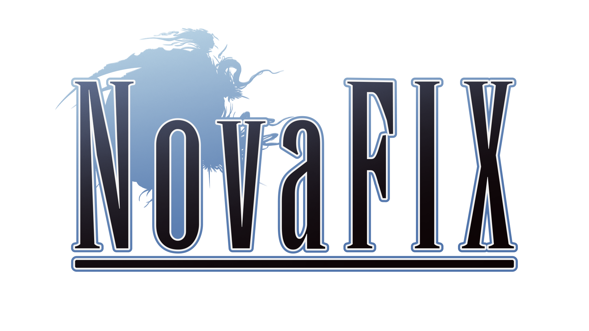

<p align="center">
  
</p>


Proxy for the PC versions of Final Fantasy XIII, Final Fantasy XIII-2, and Lightning Returns

Fixes port-specific bugs, improves high-FPS behavior, adds more graphics/input options and restores a few things missing from Lightning Returns

Check [here](docs/HOOKS_AND_PATCHES.md) for imported functions,
vtable hooks, and executable patch locations.
[And the API info is here](docs/PLUGIN_API.md).


## Features

> [!NOTE]
> All settings available in the official launcher are also available in the in-game menu.
> The list below only covers added features.


**All games**

- Automatic keyboard/controller prompt switching
- Fast controller reconnect and XInput vibration
- Correct facial animations at high frame rates

**XIII and XIII-2**

- Borderless and borderless-fullscreen modes
- Proper monitor selection
- VSync, refresh rate, triple buffering, and frame limiting
- Fixes UI clipping and alignment at resolutions above 720p
- Faster UI rendering and anisotropic filtering without affecting pixel-art/UI textures
- Fixes occasional bad frames during hard scene cuts
- WIP support for arbitrary aspect ratios

**XIII**

- Fixes field movement and Titan's route at high frame rates
- Prevents the Nautilus cutscene crash at uncommon output resolutions

**XIII-2**

- High-FPS fixes for simulation timing, root motion, chain updates, and model initialization
- Fixes jerky camera movement in Chocobo races at high frame rates
- Fixes the prologue battle breaking at high-FPS
- Fixes the one-pixel HUD sampling error above 720p
- Restores alpha-tested shadow detail
- Optional faster shadow rendering
- Mip LOD bias control
- Automatic QTE prompt switching
- Fixes Steam Cloud save crashes
- Fixes D3D9 resource-pointer crashes

**Lightning Returns**

- Removes the forced VSync cap
- Restores offline Snapshot mode with camera controls, HUD toggle, PNG output, and Compose message
- Restores Schemata renaming
- Restores Map marker renaming
- Restores White Chocobo renaming
- Prevents Steam overlay crash with DXVK on Windows


## Installation

> [!IMPORTANT]
> **DO NOT** combine it with FF13Fix or similar setups, **IT'S NOT COMPATIBLE**
>
> Only the latest Steam builds are supported. Microsoft Store releases **ARE NOT** supported yet

> [!CAUTION]
> It is **HIGHLY RECOMMENDED** to use the [Nova Chrysalia mod loader](https://github.com/LR-Research-Team/Datalog/wiki/%5BGUIDE%5D-Installing-mods-for-Nova-Chrysalia) from the [official Discord server](https://discord.gg/mvqaETHjbh) to patch the game. It applies the 4 GB patch and without it the game is likely to **CRASH** before even reaching gameplay. If you already have a 4 GB patch installed, leave it as is. If you don't, other 4 GB patches either force you to use FF13Fix or trigger Steam DRM, so **DON'T USE THEM**
>
> Nova Chrysalia is **NOT compatible with the Microsoft Store builds**. The mod loader isn't required afterward, if you're not interested in modding just launch the game through it once and that's it

### Windows

Copy `d3d9.dll` next to the game executable:

```text
XIII:   white_data/prog/win/bin/ffxiiiimg.exe
XIII-2: alba_data/prog/win/bin/ffxiii2img.exe
LR:     LRFF13.exe
```

If FF13Fix is already installed, overwrite its `d3d9.dll` with the NovaFix one

### Linux

Copy `d3d9.dll` to the same location and add this Steam launch option:

```sh
WINEDLLOVERRIDES="d3d9=n,b" %command%
```

That's basically it for the install


## Settings

`F10` opens the settings menu, controller shortcut works too - hold both stick clicks or use `Start + Back`


## DXVK and ReShade

> [!NOTE]
> The ReShade section might be a little hard to follow, but most of the complexity comes from ReShade expecting everything else to work around it

On Linux DXVK already handles D3D9 under Proton, so leave the renderer on Automatic unless you specifically want to use a local DXVK build. For local DXVK on Windows, put the 32-bit DXVK `d3d9.dll` next to NovaFix's `d3d9.dll`, rename it to `dxvk.dll` and select `Local DXVK` under Performance / Advanced

Anyway there are two ways to use ReShade on Windows

**D3D9 ReShade**

Create a `ReShade` folder next to NovaFix and put the 32-bit D3D9 ReShade DLL there as:

```text
ReShade\d3d9.dll
```

Move `ReShade.ini` and `reshade-shaders` into the newly created `ReShade` folder. With `Automatic`, ReShade loads before the system D3D9 renderer, with `Local DXVK` it loads before `dxvk.dll` and the proxy setting in `ReShade.ini` is handled automatically.

**Vulkan ReShade**

Select Vulkan for the game's actual exe in the ReShade installer, then keep NovaFix on `Local DXVK` with `dxvk.dll` next to it. ReShade installs its Vulkan layer separately, so `ReShade\d3d9.dll` isn't needed for this setup


**Any other ReShade install method will crash the game**


## Add-ons

The `addons` folder is not limited to add-ons made specifically for NovaFix.
Regular compatible 32-bit DLL/ASI mods can go there too, for example including things like
[XIII-2 Audio Fix](https://www.nexusmods.com/finalfantasyxiii2/mods/43) and
[Savior's Patch](https://www.nexusmods.com/lightningreturnsfinalfantasy13/mods/36).

If a mod comes as a DLL or ASI, putting it in `addons` is usually the safest
option. The filename does not matter, subdirectories work, and files are loaded
alphabetically, so prefixes such as `00_` and `10_` can be used to control load
order.


## Building

Install Visual Studio 2022 with the **Desktop development with C++** workload and **C++ CMake tools for Windows**

Open the repository folder -> Build it


## Reporting Issues

If you're reporting an issue, mention which game you're playing, what other mods or wrappers you're using, your system specs, and attach `NovaFix.log`. If the bug is easy to reproduce, please do it again with `Debug` logging enabled and attach that log too. Screenshots or videos help a lot. For save/progression issues, attach the save and steps to reproduce if you can.

Back up the complete save directory before replacing any live file.

Also, especially on laptops, make sure Windows isn't running in some low-power mode and that the charger is actually plugged in properly. All three games can lose a lot of performance on battery, and XIII-2 can get hit especially hard. The games are also very sensitive to overlays, screen capture or recording software, and background processes, so if performance looks much worse than it should, try disabling those first.

If the problem only shows up while recording, I can't really speak for other software, but with OBS I'd recommend using Game Capture instead of Window Capture or Display Capture. The games seem to handle that best.


## Credits

Special thanks to [Dendonflo](https://github.com/Dendonflo), [Surihix](https://github.com/Surihix), [BtEtta](https://github.com/BtEtta), H4NS, MorningSpice, [Null&Void](https://codeberg.org/hectormiguel1), and [Cyanea](https://www.nexusmods.com/profile/cyaneaBt/mods) for testing NovaFix and reporting bugs, both in the proxy itself and in the original games that I hadn't noticed on my own.

And thanks to the original [FF13Fix](https://github.com/rebtd7/FF13Fix) author and everyone who contributed to it. Their work made the entry point into the deeper fixes for these games a lot easier.


## The Boring Stuff

NovaFix is unofficial and is not affiliated with or endorsed by Square Enix.
It does not include game files; a legal installed copy of the game(s) is required.
